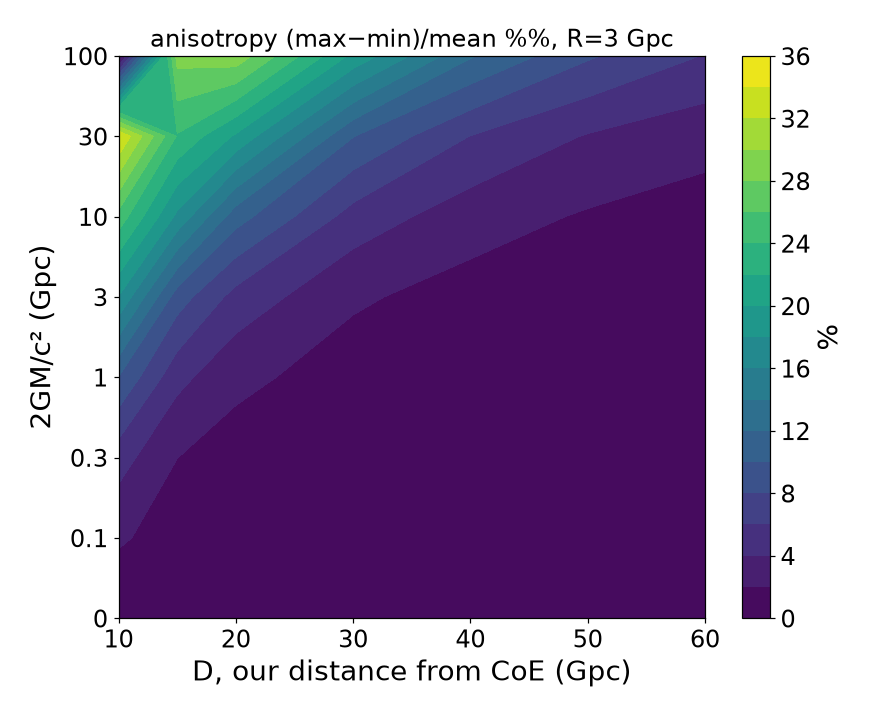
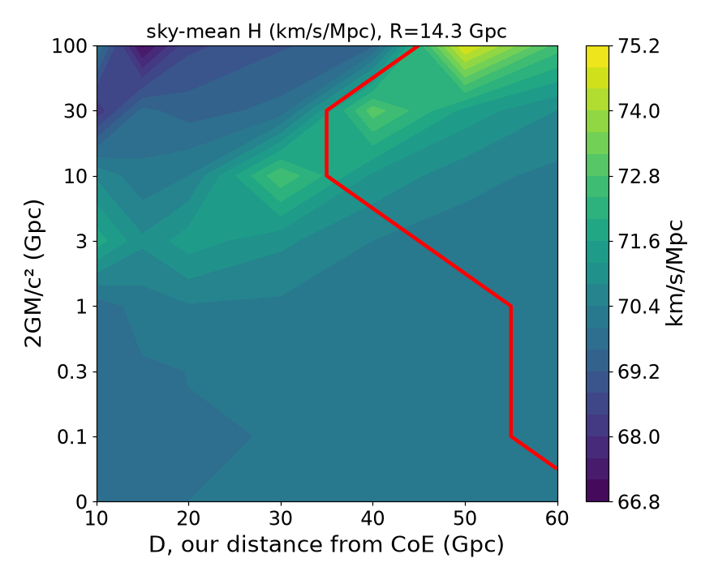
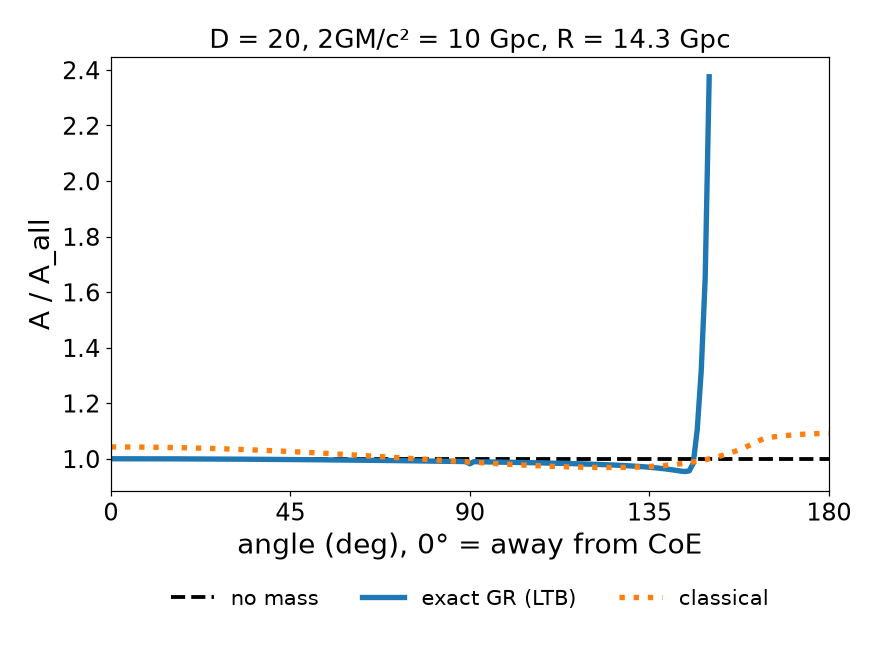
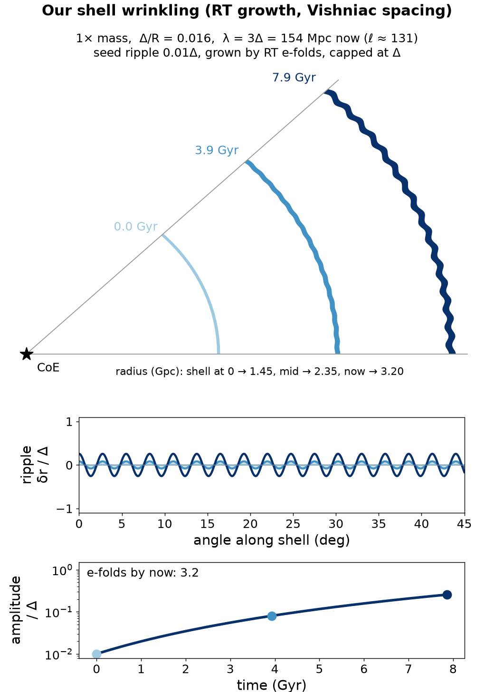
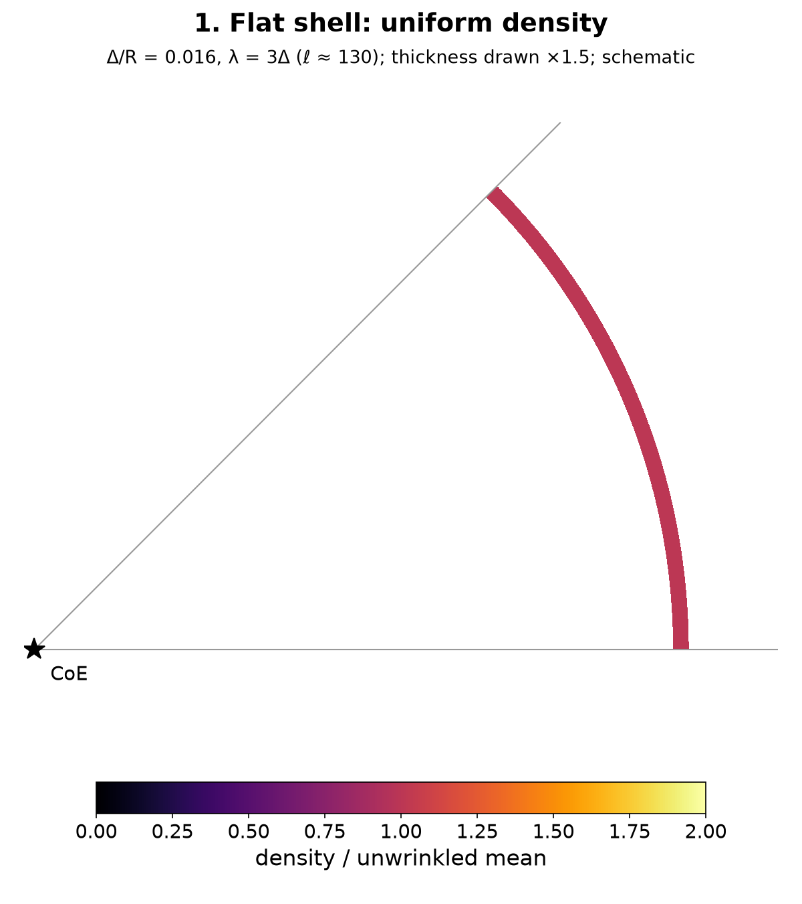

> ## ⚠️ DRAFT — work in progress: results and figures are preliminary and may change

# CoE Cosmology — Center-of-Expansion shell cosmology

**Author:** kiwipumpkin  ·  **First published:** October 13, 2026  ·  **Status:** draft / work in progress

This repository is a public, timestamped record of the Center-of-Expansion (CoE) shell cosmology: the idea, the equations, the code and the results to date. Its purpose is to establish priority for the ideas while the work continues.

---

## 1. The idea

- **Big bang from a point.** The universe is modelled as countless thin, concentric shells of matter, all launched from one point, the **Center of Expansion (CoE)**, at $t=0$.
- **We are off-centre.** Our galaxy sits on one shell, a distance $D$ from the CoE (studied for $D = 10$–$60$ Gpc). So the Hubble flow we see depends on direction: $\theta = 0^\circ$ points away from the CoE, $\theta = 180^\circ$ toward it.
- **Optional central mass.** A mass $M_c$ at the CoE decelerates the shells. Its horizon radius $2GM_c/c^2$ is a free parameter (0 to 100 Gpc here) and may extend beyond our own shell.
- **Superluminal bulk recession is allowed.** Our shell's recession from the CoE can exceed $c$ (in the runs, about 3.7c to 9c+). This is expansion of space; only *local* relative speeds between neighbouring matter must stay below $c$.
- **Only relative motion is observable.** Observers measure relative velocity and relative acceleration, never the absolute motion of their shell. In this picture, the standard "accelerated expansion" is reinterpreted as the **relative acceleration of shells near the limit of our vision**.
- **Expanding, not collapsing.** The model is expanding. In a collapsing model, sources near $90^\circ/270^\circ$ to the CoE axis would approach and appear blueshifted; no such blueshift band is seen. The angular shape of $A/A_{\rm all}$ (Hubble rate at each angle over the sky mean) also differs between the expanding and collapsing cases (`draft/models/newtonian/`).
- **Hubble anisotropy.** The predicted directional Hubble variation is compared with the X-ray cluster anisotropy reported by Migkas et al. (2020, 2021).
- **Structure from wrinkled shells.** A thin, decelerating shell is unstable to small wrinkles (thin-shell / Vishniac-type, Rayleigh–Taylor-like instability). The preferred wrinkle spacing is about $3\times$ the shell thickness. Crests and troughs seed **clumps and voids**, which keep growing gravitationally after the shell instability fades. Stacked across many shells, crests line up into walls and troughs into voids.

## 2. Key results so far

**Exact GR ray tracing (Lemaître–Tolman–Bondi), `draft/models/ltb_exact/`**
- **Classical-limit check:** with the CoE 1 Gpc away, our speed 0.2c and short range, the exact code gives $H = 72.92,\ 67.68,\ 73.07$ km/s/Mpc at $0^\circ, 90^\circ, 180^\circ$, against classical $72.93,\ 67.68,\ 73.08$. The gap shrinks toward zero as range decreases.
- **No-mass check:** $H = 70.00$ km/s/Mpc at every angle (isotropic).
- **Sweep:** 56 runs, $D = 10$–$60$ Gpc and $2GM_c/c^2 = 0$–$100$ Gpc.
  - At observation distance $R = 3$ Gpc: anisotropy about 2% (D = 60 Gpc, light mass) to 29% (D = 20 Gpc, 100 Gpc horizon). Front ($0^\circ$) and back ($180^\circ$) read high, $90^\circ$ reads low, as in the classical calculation.
  - At $R = 14.3$ Gpc: the sky-mean Hubble rate stays between 68.7 and 72.6 km/s/Mpc. Toward $180^\circ$ the line of sight either reaches the CoE or the edge of what we can see, or reads high (1.1–1.7× the sky mean); it never reads low.
  - Proper distance from us to the CoE is only 7–23 Gpc, much less than the coordinate distance $D$.
  - Three runs are invalid because our shell lies inside the central mass's horizon (D = 10 Gpc with 30 or 100 Gpc; D = 15 Gpc with 100 Gpc).

**CMB-dipole and density-field studies, `draft/analyses/`**
- The shell model's CMB pattern around the sky ring (our motion Doppler factor times gravitational redshift) is divided into the Migkas best-fit curve. The leftover is 237× the $10^{-5}$ CMB level with no extra structure.
- Point-mass clusters and voids (tidal kernel) were fitted to cancel that leftover, inside and outside our 14.3 Gpc visible sphere. For example, structure **inside** the visible sphere reaches below the 1× level: 7 masses give 0.62×, and 4 masses + 4 deep voids give 0.18× (`inside_visible/`).
- Further studies: solution-space census, joint inside+outside networks with cosmic-web rules, sequential non-overlapping placement, Einasto-style checkerboard and radial blast-wave shells, and realistic cluster/void counts. Each folder has a `summary.md`.

**Structure formation, `draft/wrinkle/`, `draft/papers/`**
- Wrinkle growth (e-folds vs wavelength) is computed along the decelerating shell history. The predicted spacing band is $\lambda \approx 2\Delta$–$5\Delta$.
- The pattern-formation paper (v5) traces flat density → wrinkle → clump/void, with density heat maps of where mass gathers.

## 3. Equations

### Newtonian shell model
$$\ddot r = -\frac{GM(r)}{r^2},\qquad v_{\rm rel} = H\,s \ \text{(locally)},\qquad H_{\rm classical}(\theta) = \frac{v_{\rm los}(\theta)}{R}$$

### Exact LTB model
Metric, with shell label $r$ and areal radius $R(r,t)$:
$$ds^2 = -c^2dt^2 + \frac{R'^2}{1+2E(r)/c^2}\,dr^2 + R^2\,d\Omega^2$$

Shell motion (all shells start at $R=0$ at $t=0$; $M_c$ softened over a 0.1 Gpc core; $E(r)$ set so the no-mass case is Milne with $H=70$ today):
$$\dot R^2 = \frac{2GM(r)}{R} + 2E(r),\qquad M(r) = M_c(r) + M_{\rm dust}(r)$$

Null geodesics in the plane through us and the CoE, with $J = R^2\,d\phi/d\lambda$ conserved:
$$\frac{dt}{d\lambda} = \frac{1+z}{c},\qquad \frac{d\phi}{d\lambda} = \frac{J}{R^2}$$
$$\frac{d^2t}{d\lambda^2} + \frac{R'\dot R'}{c^2(1+2E/c^2)}\left(\frac{dr}{d\lambda}\right)^2 + \frac{R\dot R}{c^2}\left(\frac{d\phi}{d\lambda}\right)^2 = 0,\qquad ds^2=0$$

Redshift law ($\psi$ = angle between ray and radial direction in the local matter frame):
$$\frac{d\ln(1+z)}{dt} = H_r\cos^2\psi + H_\perp\sin^2\psi,\qquad H_r = \frac{\dot R'}{R'},\quad H_\perp = \frac{\dot R}{R}$$

Directional Hubble rate and normalised anisotropy ($R_{\rm obs}$ = today's proper distance along the path):
$$H(\theta) = \frac{c\,\ln(1+z)}{R_{\rm obs}},\qquad \frac{A}{A_{\rm all}} = \frac{H(\theta)}{\langle H\rangle_{\rm sky}},\qquad \langle H\rangle_{\rm sky} = \frac{\int H\,|\sin\theta|\,d\theta}{\int|\sin\theta|\,d\theta}$$

### Thin-shell wrinkle growth
$$\sigma = \sqrt{A\,k\,g_{\rm eff}},\qquad k = \frac{2\pi}{\lambda},\qquad \lambda \approx 3\Delta$$
where $g_{\rm eff}$ is the shell's deceleration and $\Delta$ its thickness.

## 4. Key figures

| Anisotropy at R = 3 Gpc (exact LTB sweep, v1) | Sky-mean H at R = 14.3 Gpc (v1) |
|---|---|
|  |  |

| A/A_all vs angle, exact vs classical (D = 20 Gpc) | Wrinkled thin shell | Density heat map |
|---|---|---|
|  |  |  |

## 5. Repository layout

| Path | Contents |
|---|---|
| `draft/models/ltb_exact/` | **Current** exact LTB ray tracer (`ltbx.py`), production runs (`prod.py`), checks (`valid.py`, `conv.py`, `t90.py`), results (`ltbx_results.txt`) |
| `draft/models/ltb_exact/sweep/` | 56-run D × mass sweep drivers (`run2.py`) and map plotting (`plots2.py`); `old_v1/` holds the first set of maps |
| `draft/models/newtonian/` | Newtonian shell model, classical H(θ), A/A_all, Migkas comparisons, expanding-vs-collapsing tests, older redshift scripts |
| `draft/wrinkle/` | Wrinkle instability (`wr.py`, `shell_fig.py`), figures, setup/shell PDFs |
| `draft/analyses/` | CMB-residual cancellation, cluster/void networks, checkerboard, shell ensembles, reports and notes |
| `draft/papers/` | Pattern-formation paper v5 (PDF + LaTeX + figures) and wrinkle PDFs |

## 6. How to run
Requires Python 3 with `numpy`, `scipy`, `matplotlib` (`pip install numpy scipy matplotlib`).
```bash
# Exact LTB: checks and production curves
cd draft/models/ltb_exact && python valid.py && python prod.py
# Exact LTB sweep and maps
cd draft/models/ltb_exact/sweep && python run2.py && python plots2.py
# Wrinkle figures
cd draft/wrinkle && python wr.py && python shell_fig.py
# Classical H(θ)
cd draft/models/newtonian && python classical14.py
```
Large intermediate data (`*.pkl`, `*.npz`, `*.npy`) is not included; the scripts regenerate it. Some analysis scripts still contain absolute `/workspace/...` paths from the original environment.

## 7. Status and superseded items
- The Newtonian/Doppler cosmological-redshift scripts (`cosmoz*`, `ourframe14*` in `draft/models/newtonian/`) are **superseded** by the exact LTB code, which is validated against the classical limit.
- Earlier curves that read **low toward 180°** at 14.3 Gpc came from those older scripts and are **wrong**.
- The sweep maps are being updated (Hubble-tension contours, $R/D$ axis); the v1 maps are shown above.
- Open items: a finite visible-universe horizon growing from zero, and checking a reference DOI in the paper.

## 8. License and citation
Code and text are released under the [MIT License](LICENSE).

**If you use these ideas, please cite this repository** (see [`CITATION.cff`](CITATION.cff)):
> kiwipumpkin (2026). *CoE Cosmology: Center-of-Expansion shell cosmology* (draft). https://github.com/kiwipumpkin/coe-cosmology
