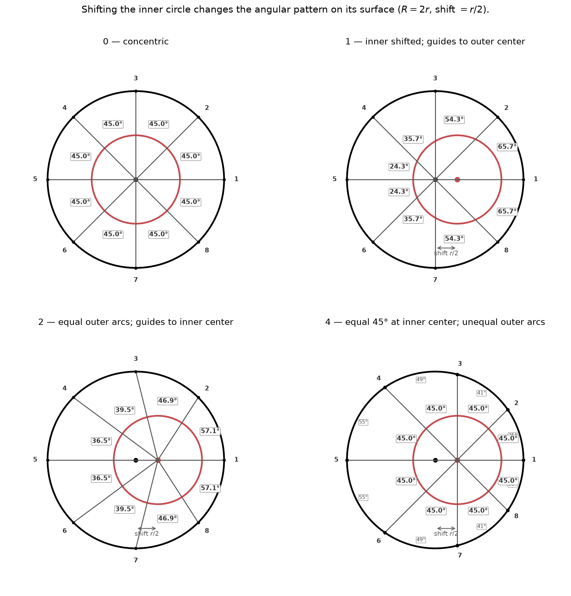

# Outer-shell heating of an offset inner shell — four scenarios

**Geometry:** \(R=2r\), \(D=r/2\). CoE at origin; inner center at \(+D\). Ray 1 = anti-CoE; Ray 5 = toward CoE.  
Whole outer shell heats; lines are guides.

Blackbody: \(\sigma T^4=F\Rightarrow T=(F/\sigma)^{1/4}\Rightarrow \delta T/T\approx\tfrac14\delta F/F\).

## Scenario 0 — concentric
Equal outer arcs → equal inner arcs. Gaps at center: all \(45^\circ\). \(F\) uniform.

## Scenario 1 — offset; rays still meet at CoE
Rays go to the **CoE**, but the **angles that matter for heating on the inner shell** are the gaps between pierce directions **as seen from the inner center** — **not** all \(45^\circ\):

| Gap | Angle at inner center |
|---|---:|
| 1–2, 8–1 | \(65.70^\circ\) (anti-CoE) |
| 2–3, 7–8 | \(54.30^\circ\) |
| 3–4, 6–7 | \(35.70^\circ\) |
| 4–5, 5–6 | \(24.30^\circ\) (CoE side) |

Also \(F\propto 1/\rho^2\) with \(\rho=\sqrt{D^2+r^2+2Dr\cos\phi}\). Hot toward CoE.

## Scenario 2 — equal outer arcs; rays → inner center
Same outer arc per guide; unequal inner angles (tight on CoE: \(36.46^\circ\) vs \(57.12^\circ\) anti-CoE).  
\(F\propto|\mathrm{d}\alpha/\mathrm{d}\beta|\). Hot toward CoE.

## Scenario 4 — equal \(45^\circ\) at inner center; unequal outer arcs
Dual of 2: each equal inner wedge gathers different outer arc — longer toward CoE. Hot toward CoE.

## Summary
| Sc | Guides | Angles to label | Hot |
|---|---|---|---|
| 0 | common center | all \(45^\circ\) at center | none |
| 1 | → **CoE** | **unequal at inner center** (24.3°–65.7°) | CoE |
| 2 | → inner center | unequal at inner center | CoE |
| 4 | → inner center | \(45^\circ\) at inner; unequal outer | CoE |
